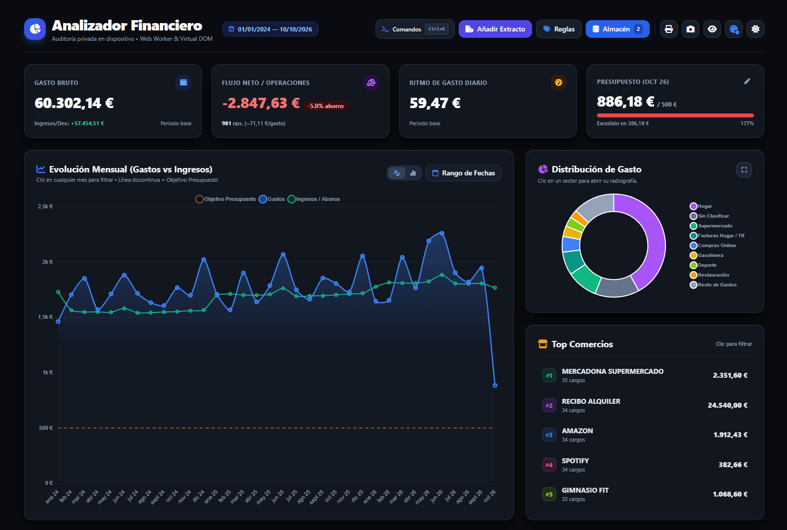
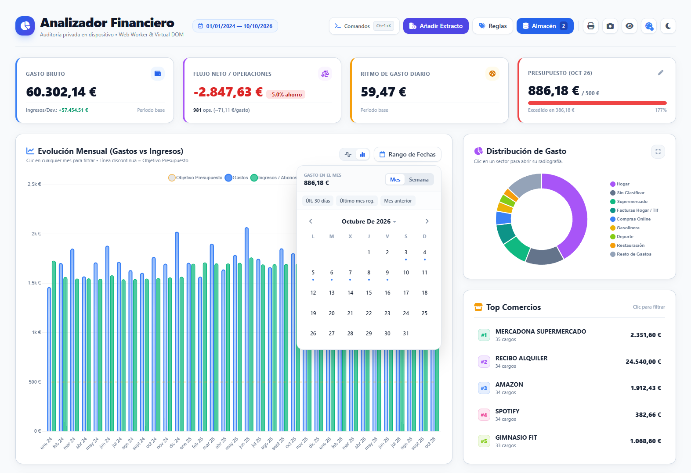
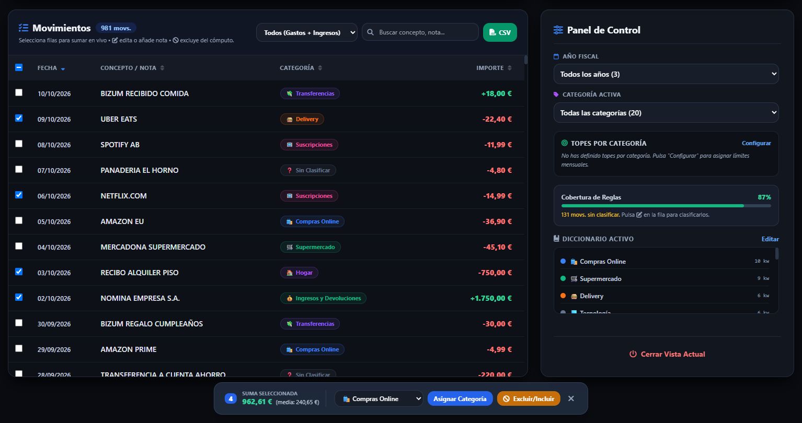
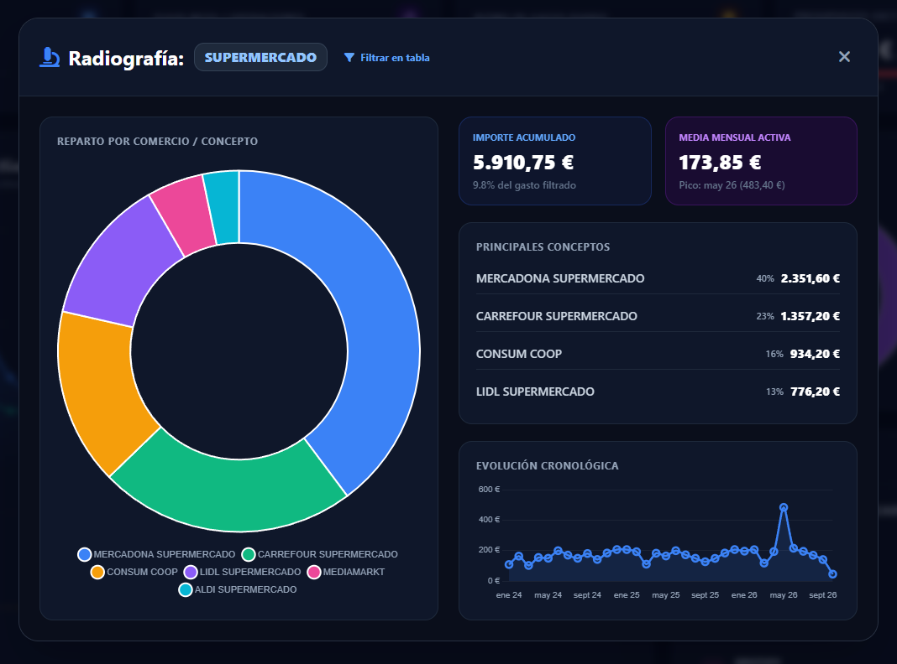
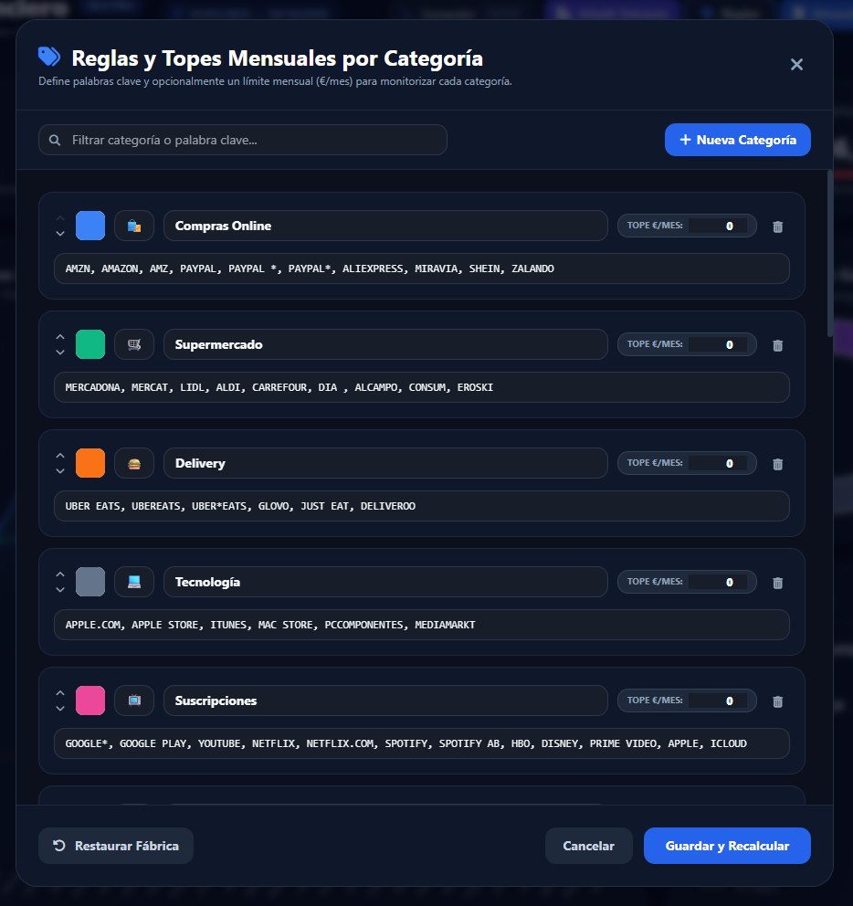
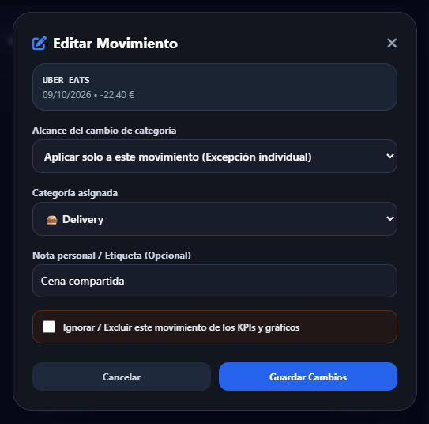
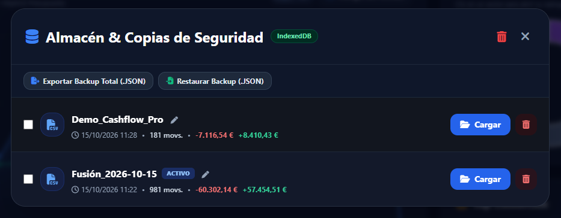
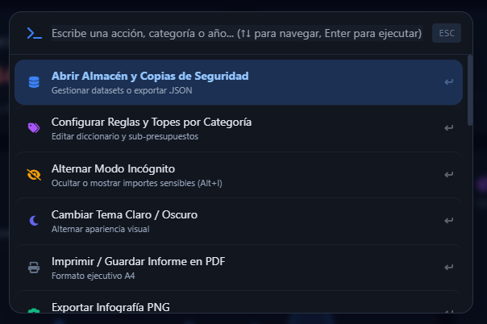

# 📊 Analizador de Datos Financieros (PWA)

[](https://github.com/cristianbr05/financial-dashboard-pwa/actions)
[](https://opensource.org/licenses/MIT)
[](https://developer.mozilla.org/es/docs/Web/HTML)
[](https://developer.mozilla.org/es/docs/Web/JavaScript)
[](https://tailwindcss.com/)

> **Aplicación Web Progresiva (PWA) de arquitectura *serverless* orientada a la auditoría, visualización y análisis de extractos bancarios y flujo de caja.**

Todo el procesamiento, clasificación, deduplicación y persistencia de datos se ejecuta estrictamente en local (*Client-side*), garantizando la privacidad de la información financiera sin dependencias de bases de datos externas ni envíos a servidores de terceros.

### 🟢 <a href="https://cristianbr05.github.io/financial-dashboard-pwa" target="_blank" rel="noopener noreferrer">Probar Demo en Vivo</a>
*(Nota: Puedes utilizar el botón "Cargar datos de demostración" dentro de la aplicación para explorar todas las funciones analíticas con ingresos y gastos simulados sin subir archivos reales).*

---

## 📸 Interfaz y Funcionamiento

| Vista General y Flujo de Caja (Modo Oscuro) | Interfaz Analítica y Calendario (Modo Claro) |
| :---: | :---: |
|  |  |
| Tabla Virtualizada, Topes y Suma Multi-selección | Radiografía por Categoría (Drilldown) |
|  |  |
| Motor de Reglas y Sub-presupuestos | Edición Individual, Notas y Exclusión |
|  |  |
| Almacén Local (IndexedDB) y Backups .JSON | Paleta de Comandos Rápida (Ctrl + K) |
|  |  |

---

## 🛠 Especificaciones Técnicas y Arquitectura

| ⚙️ Arquitectura | 💾 Persistencia Local | 📈 Motor Gráfico | ⚡ Rendimiento y Lógica |
| :--- | :--- | :--- | :--- |
| PWA (Service Workers) | IndexedDB + LocalStorage | Chart.js / Canvas 2D API | Vanilla JS + Web Workers + Virtual Scroll |

### 1. Ingesta, Procesamiento y Persistencia (*Privacy-First*)
* **Lectura Multi-formato y Autodetección de Codificación:** Importación mediante *Drag & Drop* de archivos `.csv`, `.xlsx`, `.xls` y `.json` utilizando `PapaParse` y `SheetJS`, con detección automática de codificación (`UTF-8` con *fallback* a `Windows-1252` / `ISO-8859-1`) para preservar caracteres especiales en extractos de cualquier entidad bancaria.
* **Deduplicación en Segundo Plano (*Web Worker*):** Hilo de ejecución dedicado que unifica múltiples extractos descartando transacciones duplicadas sin bloquear el hilo principal (*Main Thread*), diferenciando entre archivos reimportados y compras idénticas realizadas en el mismo día.
* **Almacén Local (`IndexedDB`) y Gestión de Sesiones:** Persistencia del historial de archivos en el navegador con recuperación automática de la última sesión activa, renombrado de datasets y fusión selectiva de múltiples archivos almacenados.
* **Copias de Seguridad Completas (`.JSON`):** Exportación y restauración íntegra del estado de la aplicación (datasets de `IndexedDB`, diccionario de reglas personalizadas, presupuestos, notas y excepciones).

### 2. Inteligencia Financiera y Analítica
* **Flujo de Caja Neto (*Cashflow*):** Procesamiento diferenciado de cargos (`-`) e ingresos/abonos/devoluciones (`+`), calculando en tiempo real el gasto bruto, ingresos acumulados, balance neto, ticket medio por operación y tasa de ahorro porcentual (`%`).
* **Presupuestos Multinivel (Global y por Categoría):** Seguimiento del límite de gasto mensual general complementado con topes individuales configurables por categoría (`€/mes`) e indicadores visuales de saturación.
* **Motor de Reglas Priorizado:** Clasificación automática por palabras clave con prioridad reordenable, colores, emojis e indicador de cobertura de clasificación en tiempo real.
* **Módulo de Radiografía (*Drilldown*):** Inspección modal por categoría con distribución de comercios, métricas de gasto máximo/promedio y curva de evolución cronológica.

### 3. Control de Movimientos y Productividad (UI/UX)
* **Tabla con Virtualización de DOM (*Virtual Scroll*):** Renderizado dinámico de ventanas de filas que permite desplazarse, buscar y ordenar por cualquier columna miles de registros históricos manteniendo 60 FPS constantes.
* **Edición Individual, Notas y Exclusión:** Capacidad para asignar excepciones de categoría a movimientos puntuales sin alterar las reglas globales, añadir notas personales de seguimiento o excluir cargos concretos (ej. traspasos entre cuentas) del cómputo de KPIs y gráficas.
* **Calculadora Multi-selección en Vivo:** Selección de múltiples movimientos en tabla con barra flotante reactiva que calcula la suma exacta, el promedio seleccionado y permite recategorizar o excluir registros en lote.
* **Paleta de Comandos (`Ctrl + K`):** Buscador modal de acciones rápidas navegable por teclado para filtrar años fiscales, saltar a categorías, abrir radiografías o ejecutar exportaciones.
* **Personalización Visual y Privacidad:** Modo Claro/Oscuro libre de destellos (*FOUC-free*), 6 paletas de color de acento basadas en variables CSS nativas y **Modo Incógnito (`Alt + I`)** mediante filtros de desenfoque selectivo.
* **Reportería y Exportación:** Generación de hojas de cálculo `.CSV` filtradas, infografías ejecutivas en `.PNG` dibujadas mediante `Canvas 2D API` y maquetación específica de impresión/informe `.PDF` en formato A4 (`@media print`).

---

## ⌨️ Atajos de Teclado

| Atajo | Acción |
| :--- | :--- |
| `Ctrl + K` / `Cmd + K` | Abrir la paleta de comandos rápida |
| `Ctrl + F` o `/` | Enfocar el buscador de movimientos en la tabla |
| `Alt + I` | Activar / desactivar el Modo Incógnito |
| `Esc` | Limpiar búsqueda activa o cerrar cualquier ventana modal |

---

## 🚀 Despliegue Local

Al ser una aplicación 100% *Client-side*, no requiere Node.js ni motores de bases de datos externos.

1. Clona el repositorio:
   ```bash
   git clone [https://github.com/cristianbr05/financial-dashboard-pwa.git](https://github.com/cristianbr05/financial-dashboard-pwa.git)
   cd financial-dashboard-pwa
   ```

2. Inicia un servidor HTTP estático en la raíz del proyecto (recomendado para habilitar el registro de *Service Workers* e instalación PWA):
   ```bash
   python -m http.server 8000
   ```

3. Abre `http://localhost:8000` en tu navegador (o ejecuta directamente `index.html` en local).